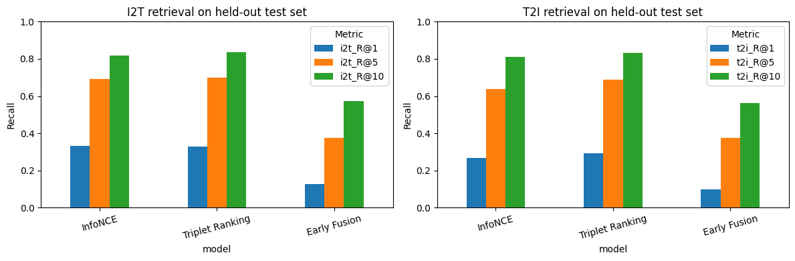
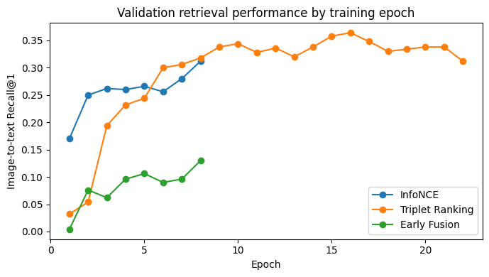
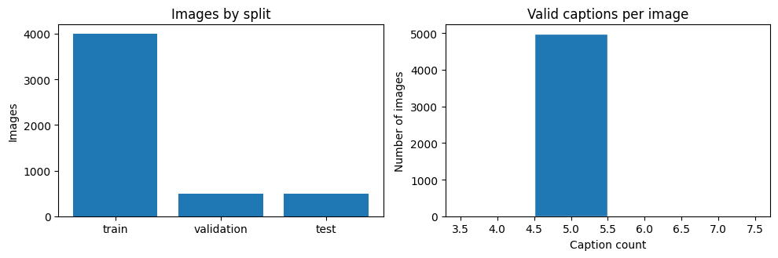

# Bidirectional Image–Caption Retrieval | COMP 6011 Project 2.2

**Individual project:** Pranav Kadari  
**Student ID:** a1987287  
**Repository:** [KadariPranav/COMP6011-ImageCaption-Retrieval](https://github.com/KadariPranav/COMP6011-ImageCaption-Retrieval)

## Project overview

This project implements and compares three multimodal approaches for **bidirectional image–caption retrieval** using a 5,000-image subset of COCO 2017 with **25,010 captions**:

- **Image → Text (I2T):** rank captions that describe a supplied image.
- **Text → Image (T2I):** retrieve an image relevant to a supplied caption.

The models use **shared, precomputed ResNet-50 image embeddings (2,048 dimensions)** and **BERT text embeddings (768 dimensions)**. Those input features were prepared as part of the originally shared project dataset; model training, comparison and analysis are documented in the individual Jupyter notebook. The shared feature archive is **not** stored in this repository.

## Methods

| Approach | Architecture and objective | Training configuration |
|---|---|---|
| InfoNCE | Two MLP projection heads map image/text features to a shared 256D embedding space; symmetric contrastive objective | Temperature 0.07, 8 epochs |
| Triplet Ranking | Same dual-encoder structure; margin ranking with top-8 negative mining and an additional all-negative term | Margin 0.2; top-8; all-negative weight 0.25; up to 24 epochs, early stopping; best checkpoint at epoch 16 |
| Early Fusion | Image/text projections and absolute difference combined into a 768D pair representation; binary match classifier | 8 epochs |

The approaches are compared on the same **image-disjoint** train/validation/test split with seed 42.

## Dataset and evaluation protocol

| Split | Images | Captions |
|---|---:|---:|
| Training | 4,000 | 20,008 |
| Validation | 500 | 2,499 |
| Test | 500 | 2,503 |
| **Total** | **5,000** | **25,010** |

All captions of a given image remain in the same split. Evaluation reports **Recall@1, Recall@5, Recall@10** and **Mean Reciprocal Rank (MRR)** for both retrieval directions. Model selection uses validation performance; the table below describes held-out test results from the executed notebook.

## Held-out test results

| Model | I2T R@1 | I2T R@5 | I2T R@10 | I2T MRR | T2I R@1 | T2I R@5 | T2I R@10 | T2I MRR |
|---|---:|---:|---:|---:|---:|---:|---:|---:|
| InfoNCE | **33.40%** | 69.20% | 81.80% | 0.4889 | 26.89% | 63.76% | 81.14% | 0.4337 |
| Triplet Ranking | 33.00% | **70.00%** | **83.60%** | **0.4920** | **29.28%** | **68.68%** | **83.30%** | **0.4611** |
| Early Fusion | 12.80% | 37.60% | 57.20% | 0.2557 | 9.95% | 37.63% | 56.17% | 0.2390 |

**Interpretation:** Triplet Ranking leads on seven of eight reported metrics, while InfoNCE has a slight lead on image-to-text Recall@1 and a lower training cost. The overlap in individual bootstrap confidence intervals does **not** establish that Triplet Ranking is statistically superior to InfoNCE. Both dual-encoder methods perform much better than this particular Early Fusion implementation.

### Recorded efficiency (CPU, downstream operations only)

| Approach | Training (seconds) | Test scoring (seconds) |
|---|---:|---:|
| InfoNCE | 10.68 | 0.072 |
| Triplet Ranking | 29.50 | 0.073 |
| Early Fusion | 98.95 | 10.534 |

Early Fusion's exhaustive pair scoring took approximately **145×** as long as InfoNCE scoring for this test setup. These times **exclude** original ResNet-50/BERT feature extraction and should not be interpreted as end-to-end deployment latency.

## Results visualisations







## Files in this repository

```text
COMP6011-ImageCaption-Retrieval/
├── README.md
├── COMP6011_Image_Caption_Retrieval.ipynb   # executed notebook
├── DATA_AND_REPRODUCIBILITY.md             # input and rerun guidance
├── requirements.txt                        # dependencies
├── execution_environment.txt               # recorded environment
├── test_metrics.csv                        # held-out metrics
├── bootstrap_ci.csv                        # uncertainty estimates
├── data_quality.png
├── retrieval_comparison.png
├── validation_curves.png
└── .gitignore
```

## Reproduce the experiment

1. Obtain the approved shared archive **`multimodal_shared_data(1).zip`** (or rename it `multimodal_shared_data.zip`) from the project's authorised course/shared-data location. The archive is not published here; contact the project owner or course staff if you lack access.
2. The ZIP should contain `shared_data/coco_splits.json`, `shared_data/image_features.pt`, `shared_data/text_features.pt` and `results/dataset_audit.json`.
3. Open [the executed notebook](COMP6011_Image_Caption_Retrieval.ipynb) in Google Colab or Jupyter. Place the ZIP in the notebook working directory, or upload it through the Colab Files panel. **The notebook automatically extracts the archive.**
4. For local Jupyter, install the appropriate PyTorch build for your machine and run `python -m pip install -r requirements.txt`. Colab may already include the required packages.
5. Run all notebook cells in order. The notebook checks data alignment, trains three models, evaluates retrieval, and writes generated artefacts to `individual_coco_results/`.
6. Compare `individual_coco_results/test_metrics.csv` and the generated graphs against the archived `test_metrics.csv` and PNG files **in this repository's root directory**.

Re-running on a different CPU/GPU, PyTorch version or runtime may alter training time and some results. A clean-runtime reproduction has not been independently certified. More details: [Data and reproducibility notes](DATA_AND_REPRODUCIBILITY.md).

## Assignment deliverables

- **Source code and recorded notebook outputs:** [COMP6011_Image_Caption_Retrieval.ipynb](COMP6011_Image_Caption_Retrieval.ipynb)
- **Implementation report (PDF):** submitted separately through the course portal; not currently hosted in this repository.
- **Presentation slides (PDF):** submitted separately through the course portal; not currently hosted in this repository.
- **Three-minute recorded presentation:** submitted separately through the course portal; no public video link provided.

If report, slides or video are later uploaded here with permission, this section can be updated with links to the actual files. The course submission portal remains the authoritative location for assessed deliverables.

## Limitations, ethics and responsible use

- The experiment uses frozen encoders, a single COCO subset and one random seed; results may not generalise to other domains or random initialisations.
- Query-bootstrap confidence intervals capture test-query sampling uncertainty, not retraining variability or a paired significance test.
- COCO captions and pretrained encoders may contain representational biases; demographic subgroup fairness was **not** evaluated.
- Images involving people may raise privacy and consent considerations. Retrieved results should not automatically be treated as ground truth.
- Failure explanations, such as visually crowded scenes or ambiguous captions, remain hypotheses until verified against individual examples.

## AI-use transparency

Generative AI was used only for support: debugging code errors, checking grammar, and getting brief background on unfamiliar topics. All ideas and analysis are my own.

## References

- Lin, T.-Y. et al. (2014). *Microsoft COCO: Common Objects in Context*. ECCV. https://arxiv.org/abs/1405.0312
- He, K. et al. (2016). *Deep Residual Learning for Image Recognition*. CVPR. https://arxiv.org/abs/1512.03385
- Devlin, J. et al. (2019). *BERT: Pre-training of Deep Bidirectional Transformers for Language Understanding*. NAACL. https://arxiv.org/abs/1810.04805
- Radford, A. et al. (2021). *Learning Transferable Visual Models From Natural Language Supervision*. ICML. https://arxiv.org/abs/2103.00020
- Faghri, F. et al. (2018). *VSE++: Improving Visual-Semantic Embeddings with Hard Negatives*. BMVC. https://arxiv.org/abs/1707.05612
